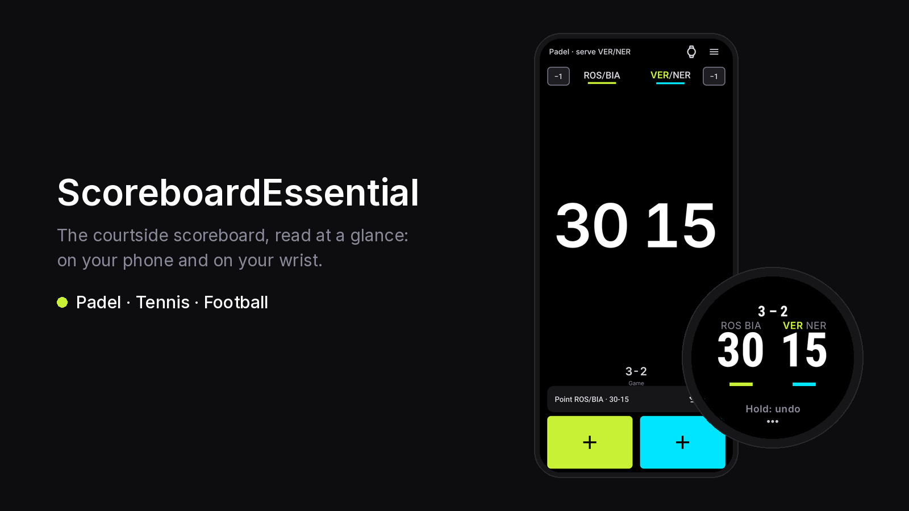
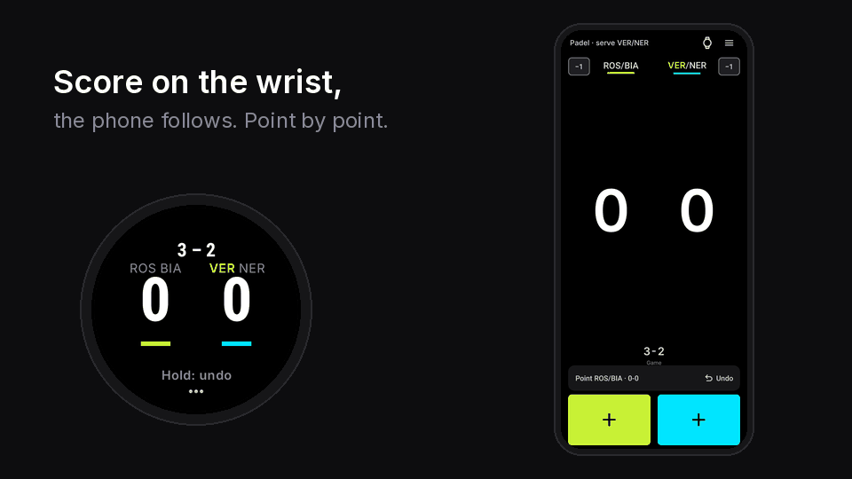
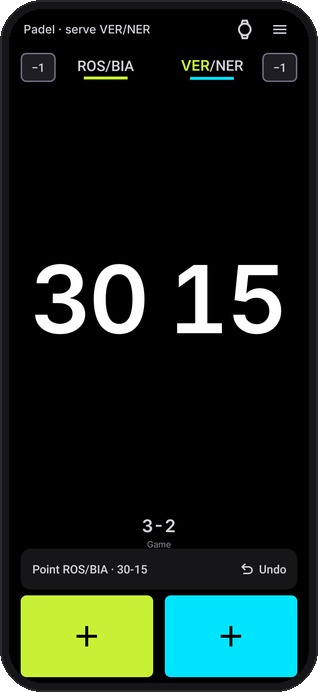
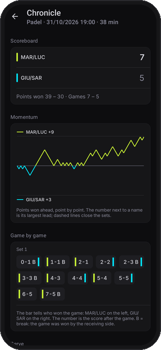
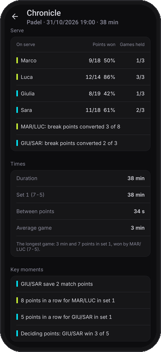
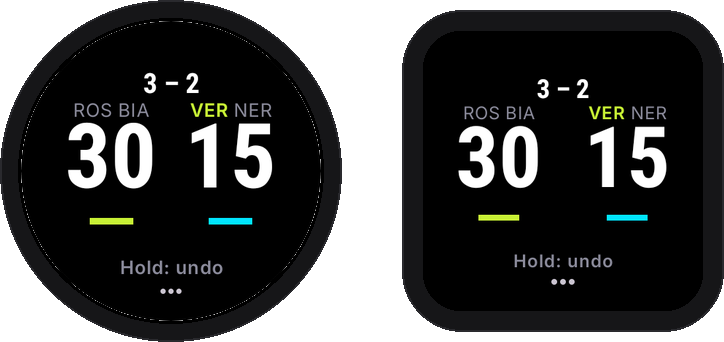
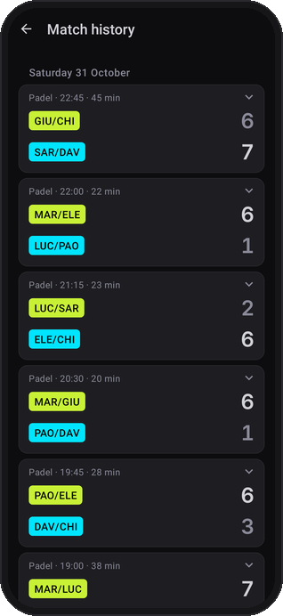
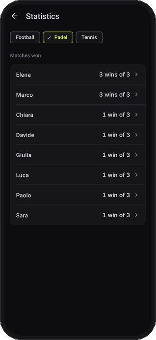

<p align="center">
  
</p>

<p align="center">
  <a href="https://github.com/vantaggi/ScoreboardEssential/actions/workflows/android.yml"></a>
  <a href="https://github.com/vantaggi/ScoreboardEssential/releases/latest"></a>
  
  
  
</p>

# ScoreboardEssential

A courtside scoreboard for **padel, tennis and football**, on an Android phone and on a Wear OS
watch. Big white digits on pure black, read at a glance from two metres away; one tap with the
thumb to score; the watch and the phone always show the same match. Everything works offline.

<p align="center">
  
</p>

## What it does

<table>
  <tr>
    <td align="center" width="33%"></td>
    <td align="center" width="33%"></td>
    <td align="center" width="33%"></td>
  </tr>
  <tr>
    <td valign="top"><b>Scoreboard.</b> One number per side, the team colour only on the big + zone
    and on the bar under the name. In padel the pair's initials stay in view, and the one who
    serves turns lime.</td>
    <td valign="top"><b>Chronicle.</b> Every point is kept, so a finished match tells its story:
    the momentum chart, game by game, breaks marked.</td>
    <td valign="top"><b>Serve and key moments.</b> Points won on serve by each player, break points
    converted, the length of the match and of each set, the runs and the saved match points.</td>
  </tr>
  <tr>
    <td align="center"></td>
    <td align="center"></td>
    <td align="center"></td>
  </tr>
  <tr>
    <td valign="top"><b>On the wrist.</b> Round and square faces. Tap a side to score, hold to undo.
    The phone can stay in the bag: the watch keeps scoring and catches up when they meet again.</td>
    <td valign="top"><b>History.</b> Matches grouped by day, with sport, start time and length;
    each one opens its Chronicle, can be exported or sent to Padel Elite.</td>
    <td valign="top"><b>Statistics per sport.</b> Matches won in padel and tennis; goals,
    appearances and win rate in football, with a card for each player.</td>
  </tr>
</table>

Also inside: **padel evenings** with rotating pairs and groups, **football** with match clock,
goalkeeper rotation timer and scorers, three themes (dark, light, high contrast), English and
Italian, and an optional link to the **Padel Elite** dashboard that receives finished matches.

## Quick start

1. **Pick the sport and the players.** Open the Match sheet (the ☰ button), then Settings: choose
   padel, tennis or football. Add players to the two sides under Team rosters. With two players a
   side the pairs show their initials (ROS/BIA) and the app follows who serves.
2. **Score.** Tap a team's big + zone on the phone, or tap a side of the watch face. Undo takes
   back the last point. Phone and watch stay in step while they are connected.
3. **Read the match.** End match in the Match sheet. The match goes to History: open it to see its
   Chronicle, export it or send it to Padel Elite.

> The screenshots come from the real app with made-up players, rendered with Robolectric
> (`scripts/vetrina.sh`, no emulator needed). Run it again after a UI change to refresh
> `docs/media/`.

## Project architecture

A multi-module Android project with a clean separation of concerns:

* **`core`** — the sport rules and the match engine (football, padel, tennis), plain Kotlin and
  shared by phone and watch.
* **`mobile`** — the phone application (Android Views + View/Data Binding, `ViewModel` +
  `LiveData`, Room, a foreground `MatchTimerService`).
* **`wear`** — the Wear OS companion (Views + ViewBinding, `ViewModel` + `StateFlow`).
* **`shared`** — common code used by both apps: the Wearable Data Layer sync engine
  (`OptimizedWearDataSync`), the wire-protocol constants (`WearConstants`), the transport model
  (`PlayerData`), validation (`WearDataValidator`) and haptics (`HapticFeedbackManager`).

## Tech stack

* **UI:** Android Views with View/Data Binding
* **State:** `ViewModel`, `LiveData` (mobile) and `StateFlow` (wear)
* **Database:** Room
* **Phone ↔ Watch:** Google Play Services Wearable Data Layer (DataItems + Messages)
* **Architecture:** lean MVVM (ViewModel → Repository → DAO)

## Building

```bash
# Debug builds
./gradlew :mobile:assembleDebug :wear:assembleDebug

# Tests and lint
./gradlew test lint

# Release bundles (see Release signing below)
./gradlew :mobile:bundleRelease :wear:bundleRelease
```

### Release signing

Release builds are signed only if a git-ignored `keystore.properties` exists at the repo root:

```properties
storeFile=path/to/release.jks
storePassword=********
keyAlias=********
keyPassword=********
```

Without it, debug builds work normally and release builds are produced unsigned. The phone and
watch share an `applicationId` (`it.vantaggi.scoreboardessential`); the watch uses a `2000+`
`versionCode` offset so its bundle never collides with the phone's.

### Sending a padel match to Padel Elite (optional)

The phone app can send a finished padel match to a Padel Elite group's inbox (an admin then opens
it in the dashboard). The feature is **off** unless the build knows the Supabase project. Put the two
values in the git-ignored `local.properties` at the repo root (or in CI environment variables of the
same names):

```properties
PADEL_ELITE_SUPABASE_URL=https://<project>.supabase.co
PADEL_ELITE_SUPABASE_KEY=<the project's publishable key>
```

Without them no command appears and the app is identical to a build without the feature. Never put
the service-role key here: only the publishable (public) key, whose safety rests on the database's
RLS and RPCs. `local.properties` must never be committed (it is in `.gitignore`).

Design note: the client is plain REST on `HttpURLConnection` (GoTrue for email/password sign-in and
token refresh, PostgREST for groups and status, the `submit_scoreboard_match` RPC for delivery), the
session is encrypted with an Android Keystore AES-GCM key, and the retry queue is WorkManager: the
only new runtime dependency is `androidx.work`. No Supabase or OkHttp library, no Google Sign-In.

## Data and privacy

All data is stored locally in a Room database; nothing is uploaded unless you choose to send a
padel match to Padel Elite. Android auto-backup is
disabled (`allowBackup="false"`). See [PRIVACY_POLICY.md](PRIVACY_POLICY.md).
